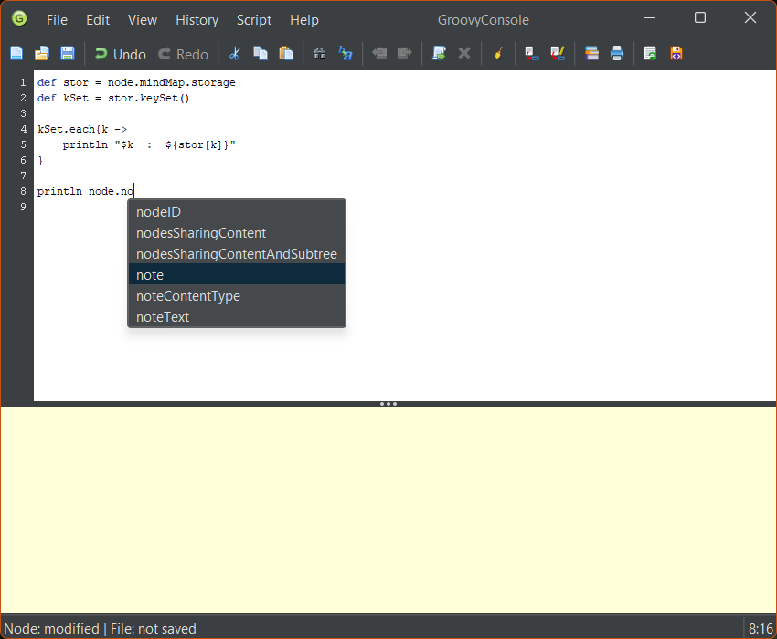
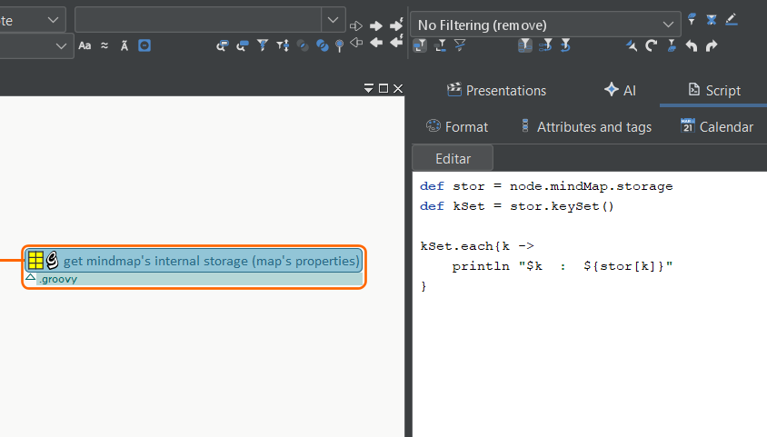

# GroovyConsole for Freeplane

Write, run, and edit Groovy scripts inside Freeplane. GroovyConsole offers syntax highlighting and code completion for the Freeplane scripting API, Java, and Groovy.

## Install and run your first script

1. Download the `.addon.mm` file from [GitHub Releases](https://github.com/EdoFro/Freeplane_groovyConsole/releases).
2. Open the file in Freeplane, complete the installation, and restart Freeplane. The add-on declares **Freeplane 1.13.3** as its minimum version. The v0.1.0 reload and Undo/Redo fixes were tested in **1.13.5**.
3. Select a node and run **Open with groovy console** from the add-on menu.
4. Type `println node.text` and click **Run** to print the node's text. As you type `node.te`, look for the `text` suggestion. Press **Ctrl+Space** to reopen the suggestions.

## Edit a script stored in a node

The **Script** tab in Freeplane's Tool Panel previews the selected node's `script1` attribute. It refreshes when you select another node or the attribute changes. If the tab is hidden, run **Show script tab** from the add-on menu.

Click **Edit** to open the script in GroovyConsole. When you're done, click **Send to node**, then save the map. GroovyConsole can also work with scripts stored in node notes.

## Edit in IntelliJ

Use **Create temporary .groovy** to export a script. Edit and save it in IntelliJ, then use **Reload from file** and **Send to node** to bring your changes back into the map. [Temporary scripts guide](groovyConsole/TEMPORARY-SCRIPTS.md)

## Documentation

GroovyConsole also includes tools from Groovy Swing Console. Open the **Script** menu to inspect the last result, see script variables, or examine how Groovy parses your code. [Groovy Swing Console tools](docs/USER-GUIDE.md#groovy-swing-console-tools)

- [User guide](docs/USER-GUIDE.md) for shortcuts, toolbar buttons, save destinations, and preferences.
- [Build and test guide](docs/BUILDING.md) for Gradle setup and automated checks.
- [Version history](groovyConsole/history.md) for changes by release.
