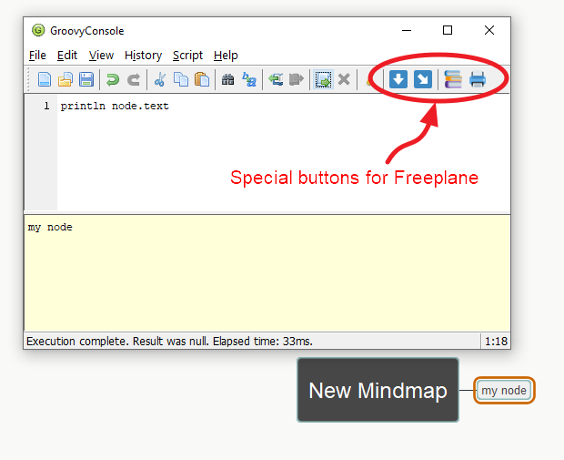
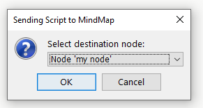
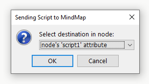
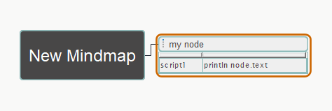
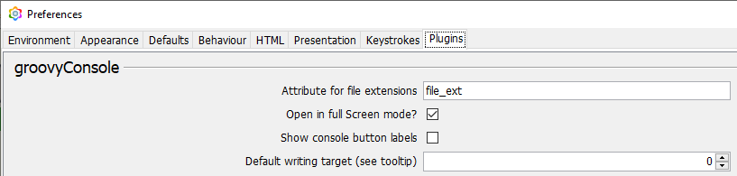

-----

# New Groovy Console for Freeplane

A Groovy 4 console integrated with Freeplane, with node-based scripts and temporary files for editing in IntelliJ.

-----

## 1. about "groovyConsole add-on"

groovyConsole is an add-on for Freeplane that opens a Groovy Console and works with Groovy 4 and can be used with the new versions of Freeplane.

### What's new in v0.0.10

- The editor suggests variable names, properties and methods from the Freeplane scripting API, Java and Groovy, including Groovy extension methods. It uses declarations, simple assignments, imports and chained calls to infer types without running the script.
- Suggestions appear as you type. Use **Ctrl+Space** to reopen them or **Ctrl+K** to complete a word already in the script. **Enter** completes the prefix and **Tab** replaces the whole identifier. Method suggestions insert or reuse parentheses.
- **Ctrl+Z** undoes a completion in one step, including any suffix replaced by Tab. Undo and Redo operate on the console text.
- **Ctrl+Shift+K** or **Ctrl+/** toggles line comments. With the suggestions menu closed, **Tab** indents selected lines to the next four-column stop and **Shift+Tab** moves them to the previous stop.
- Syntax colors distinguish Groovy keywords, strings, numbers and comments.
- The Tool Panel's **Script** tab shows the selected node's `script1` attribute in a read-only Groovy editor. It refreshes when you change nodes or update the attribute. **Edit** opens GroovyConsole and saves back to that node's `script1`.
- The **Script** tab opens when Freeplane starts with GroovyConsole enabled. You can also open it from the add-on menu with **Show script tab**.
- The **Script** tab uses a theme-aware script icon, including when TabbedPanelMod is enabled.
- To open GroovyConsole by double-clicking the script text, enable **Open Script tab editor on double-click** in the GroovyConsole preferences. This option is off by default.

From the add-on directory, run `gradlew.bat check` to verify completion, inference, comments, indentation and Undo/Redo with highlighting enabled. The editor checks require a graphical environment and run without opening Freeplane.

### Planned Script tab improvements

- Let the **Script** tab follow Freeplane's editor background. The tab currently shares GroovyConsole's white editor background. Use a separate syntax palette for the tab so keywords, strings, numbers and comments stay readable in both themes and GroovyConsole keeps its existing colors.
- Verify the palette with the **Script** tab and GroovyConsole open together in both light and dark themes.

### What's new in v0.0.9

- Edit node scripts in IntelliJ through temporary `.groovy` files, then reload them in the console and send them back to the node.
- Keep node changes and file changes independent, with warnings before discarding or overwriting different versions.
- Review expired temporary files in a non-blocking window, with configurable retention and postponement.

See the [version history](groovyConsole/history.md) and the [temporary scripts guide](groovyConsole/TEMPORARY-SCRIPTS.md).



<details><summary><h3>1.1. Additional features:</h3></summary>

- It has access to the Freeplane API so it can interact with nodes and maps
- It can load / save script files to be used with Freeplane
- It can 'save' scripts as node's notes or attributes
- If you select a node that has a script and then you open the groovy console, the script will be automatically loaded in the console editor
- You can edit the script and 'save' it back to the node
- You can choose if you want to save the script in its original node or into the currently selected one
   - 
- You can choose if you want to 'save' it as a note or as 'script1' attribute
   - 

The script stays in the map, so you don't need to have multiple files for you short scripts



</details>
<details><summary><h3>1.2. Additional buttons</h3></summary>

|Button|Label|Description|
|----|----|----|
||Send to node|Save script into node|
||Config + send to node|Select options and save script into node|
||Refresh Compiler Config|Refreshes the Freeplane's **GroovyScript Compiler Configuration**<br>(libraries included)|
||Starts System.out interceptor|Restarts the ```systemOutInterceptor``` so that ```print()``` and ```println()``` get written in the log file or the console.<br>Use '**View / Capture Standard Output**' to direct the output to the console or to Freeplane's *log.0* file|
||Reloads script from file|Reloads script from file into the editor pane in Groovy Console.<br>This is useful, for example, when you want to discard all changes or when you are editing the script with an IDE like IntelliJ but want to test the script with the Groovy Console.|
||Create / save temporary .groovy|Creates one temporary file from the current script. Later clicks save the same associated file, just like normal Save. The original node remains available as a separate destination.|

</details>
<details><summary><h3>1.3. Add-on configuration</h3></summary>



You can configure some parameters of the add-on in Freeplane 's preferences.

|parameter|Description|Default value|Notes|
|----|----|----|----|
|Attribute for file extensions|Name of the attribute to indicate the file extension associated with the node|file_ext|When you decide to save a script as a node's note, it will 'mark' this node by defining its details to '.groovy'. But if its details have a text allready, then it will add a new attribute to the node to do this. The name of this attribute is defined in this preference.|
|Open in full Screen mode?|Groovy Console must open in full screen mode|true|I choose true because I work with two monitors and this way it opens allways in fullscreen mode in the other monitor.|
|Show console button labels|Shows the labels of the buttons added to thr Groovey Console's toolbar|true|The default value is true, so new users can become familiar with this buttons.<br>I have this option turned off|
|Default writing target|Defines which is your preferred destination when writing (saving) a script into a node:<br>  0. its note<br>  1. "script1" attribute|1. "script1" attribute|Everytime you save a new script in a node, it asks you where do you want to save it in (node or script1).<br>This parameter indicates which is the preselected option.<br>Personally I prefer to save my scripts in the notes, because this way I can look at them easier, but using script1 has its advantages too: they can be directly executed by Freeplane.|

</details>
-----

## Working with IntelliJ and temporary scripts (v0.0.9)

Before choosing the temporary scripts folder, follow Freeplane's [IntelliJ IDEA installation and configuration guide](https://docs.freeplane.org/scripting/intellij-idea-setup.html#installation-and-configuration) to prepare a Groovy scripting project with the Freeplane libraries. Choose a folder inside that configured project for your temporary scripts.

1. Open the console from a node containing a script.
2. Click **create temporary .groovy**. Choose a folder on first use, preferably inside your IntelliJ scripts project. The filename is generated from the original node text and gets a suffix when needed to avoid overwriting another file.
3. Edit the UTF-8 file in IntelliJ and save it there.
4. Use **reload from file** in the console before executing or sending that version to a node.
5. Use **send to node** to preserve the script in the map, then save the map normally.

After creation, **save temporary .groovy** and the diskette update the associated file. Saving the file does not mark node changes as saved; sending to a node does not silently update the file. Creating a temporary also marks the console dirty because that file must be reviewed on close, even if its code is unchanged.

The console warns about unsaved changes and detected external file changes. It does not open IntelliJ automatically or see edits that remain unsaved in IntelliJ.

### Deferred cleanup

Closing a console does **not** delete its temporary files. It schedules eligible files for later review: the file is unchanged since creation, or its latest revision was reloaded and then sent to a node, with no remaining node changes and with the editor still matching the file.

When a console opens, it checks the configured temporary folder. If there are expired candidates, an independent window appears; you can keep using the console while reviewing it.

| Action in the review window | Result |
|---|---|
| Check a file | Select it for postponement. |
| Click **Apply** | Postpone checked files from now by the configured period; delete unchecked files and their metadata sidecars. |
| Close without applying | Keep every file. |

Reopening, reloading or saving a managed temporary cancels its pending cleanup. Detected external changes also cancel it. Apply rechecks candidates and preserves changed files or files used by an open managed console. Old files without valid metadata are not automatically deleted.

Each new temporary has a `.freeplane-temp.json` sidecar in the same folder and a generated origin comment. The console removes only its recognized generated header when loading, so it is not sent to the node. Origin dates are informational; they do not prove the map was saved with that script. Save your map normally after sending code to a node.

### New preferences

These settings are available alongside the existing add-on preferences in Freeplane:

| Preference | Default | Purpose |
|---|---|---|
| Temporary Groovy scripts folder | Empty | Ask for a folder on first use and remember it. |
| Temporary scripts retention (days) | 7 | Waiting period for cleanup and the period added when postponing a file. |

### Compatibility and validation

The minimum Freeplane version selected for v0.0.9 is **1.13.3**. The add-on was built with Java 17, Gradle 8.0 and Groovy 4.0.27 against the separate official Freeplane 1.13.3 distribution. Installed add-on workflows were manually tested in Freeplane 1.13.4 with Java 21.0.11 and Groovy 4.0.27. A brief installed-package smoke test on 1.13.3 is still required before publishing this minimum as validated support.

The automated suite covers 94 checks, including independent save states, scripts not yet saved in a node, filename collisions, deferred cleanup, refreshing an existing review window, Windows line endings and the FastStringService failure. Run `gradlew.bat --offline verifyTemporaryScripts jar` from `groovyConsole` after the build dependencies are available locally.

### Building from another checkout

1. Use Java 17 and the included Gradle 8.0 Wrapper.
2. Extract an official Freeplane **1.13.3** distribution into a folder of your choice; it does not need to be your installed application.
3. Copy `groovyConsole/gradle.properties.example` to `groovyConsole/gradle.properties` and set `freeplaneDir` to that folder. This machine-local file is ignored by Git. On Windows, use forward slashes. Relative paths are resolved from `groovyConsole`.
4. From `groovyConsole`, run `gradlew.bat check jar`. Once Maven dependencies are cached, you can add `--offline`.

To override the folder for one build without editing any file:

```powershell
.\gradlew.bat check jar "-PfreeplaneDir=C:/libraries/freeplane-1.13.3"
```

Freeplane library filenames are pinned to 1.13.3, and Groovy is pinned to 4.0.27. Missing configuration or missing libraries produces an explicit error before compilation. The dependency distribution and local settings are not committed. The official 1.13.4 `freeplaneviewer.jar` failed signature verification during compilation; building against 1.13.3 avoids that separate issue without replacing the installed Freeplane application.

See the [detailed guide](groovyConsole/TEMPORARY-SCRIPTS.md) for the remaining manual checks and implementation limits.

-----

## 2. about the "Groovy Console"

The **Groovy Swing Console** is a standard component from the Groovy language.
It allows a user to enter and run **Groovy scripts**.

It looks like this:


more information about it and all its features can be found in the [Groovy Console official page](https://docs.groovy-lang.org/latest/html/documentation/groovy-console.html)

-----

## 3. about "wikdshell add-on"

wikdshell is an add-on that opened a Groovy Console to write and use scripts with Freeplane.

wikdshell works with Freeplane versions up to v1.9.15.

But with the new versions starting as v1.10.1 it doesn't work any longer.

