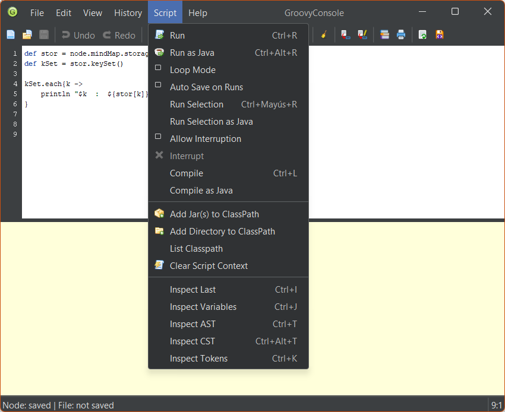

# GroovyConsole user guide

GroovyConsole embeds the [Groovy Swing Console](https://docs.groovy-lang.org/latest/html/documentation/groovy-console.html) in Freeplane and gives scripts access to the Freeplane scripting API.

## Open and save scripts

Select a node and run **Open with groovy console**. The console can load scripts from linked Groovy files, the node's `script1` attribute, or a node note marked as Groovy. The Tool Panel's **Script** tab previews `script1`. Its **Edit** button opens that script with its original node and attribute as the save destination.

| Destination | How to save |
| --- | --- |
| Original node | Use **Send to node**. |
| A different node, a note, or a `script1` attribute | Use **Config + send to node** and choose the destination. |
| A regular script file | Use **Save As** to choose a file, then **Save** to update it. |
| A temporary file for IntelliJ | Use **Create temporary .groovy**. See the [temporary scripts guide](../groovyConsole/TEMPORARY-SCRIPTS.md) for reloading, tracking changes, and cleanup. |

Save the map after sending a script to a node to persist the change on disk.

## Editor shortcuts

| Shortcut | Action |
| --- | --- |
| **Ctrl+Space** | Open completion suggestions. |
| **Ctrl+K** | Complete a word already in the script. |
| **Ctrl+Shift+H** | Pin the selected text for this console session. Press again to expand the selection to word boundaries and match whole words. Press a third time to remove the mark. Selecting text previews its exact, case-sensitive matches. |
| **Enter** with suggestions open | Accept the suggestion and complete the prefix. |
| **Tab** with suggestions open | Accept the suggestion and replace the whole identifier. |
| **Esc** | Close the suggestion list. |
| **Ctrl+Shift+K** or **Ctrl+/** | Toggle line comments. |
| **Tab** / **Shift+Tab** with suggestions closed | Move selected lines to the next or previous four-column indentation stop. |
| **Ctrl+Z** / **Ctrl+Y** | Undo or redo console edits. Reloading from disk starts a fresh editor history. |

The editor uses declarations, simple assignments, imports, and chained calls to infer types as you write. Method completion inserts or reuses parentheses and places the cursor according to the selected signature.

## Groovy Swing Console tools

The **Script** menu gives you access to the inspection tools built into Groovy Swing Console.

| Command | What it shows |
| --- | --- |
| **Inspect Last** | The last execution result and its object details. |
| **Inspect Variables** | Variables in the current script context. |
| **Inspect AST** | The abstract syntax tree, which shows the structure Groovy uses to compile the script. |
| **Inspect CST** | The concrete syntax tree, which shows how Groovy parsed the source. |
| **Inspect Tokens** | The tokens Groovy recognized in the source. |

The same menu lets you run selected code, compile the script, manage the classpath, and clear the script context.

## Add-on toolbar buttons

| Button | Action |
| --- | --- |
|  **Send to node** | Save the script to its node destination. |
|  **Config + send to node** | Choose the node and whether to save to its note or `script1` attribute. |
|  **Refresh Compiler Config** | Refresh Freeplane's Groovy script compiler configuration, including its libraries. |
|  **Starts System.out interceptor** | Restart output capture for `print()` and `println()`. Use **View → Capture Standard Output** to direct output to the console or Freeplane's log. |
|  **Reload from file** | Replace the editor contents with the saved file. |
|  **Create / save temporary .groovy** | Create a temporary script file or update the one already associated with the editor. |
| **Manage highlights** | List pinned marks for this console, change their color, or remove them. **Whole word** keeps the pinned text as entered and matches it at word boundaries. **Add regex…** pins a Java regular expression, such as `node\d+`. |

Click a mark's text in **Manage highlights** to edit it. Saving keeps its color and whole-word setting. An invalid regex is reported so you can correct it before applying the edit.

Each row shows the number of matches in the editor. Use **↑** and **↓** to select the previous or next match. The arrows wrap at the beginning and end of the script.

## Preferences

| Preference | Default | Purpose |
| --- | --- | --- |
| Attribute for file extensions | `file_ext` | Name of the attribute used to mark a Groovy note when the node's details already contain text. |
| Open in full screen mode | On | Open the console maximized. |
| Show console button labels | On | Show labels for the add-on buttons. |
| Default writing target | `script1` attribute | Preselect a node note or the `script1` attribute when choosing where to save. |
| Open Script tab editor on double-click | Off | Open GroovyConsole by double-clicking the script preview. |
| Temporary Groovy scripts folder | Empty | Ask for a folder on first use and remember it. |
| Temporary scripts retention (days) | 7 | Set the waiting period for cleanup and the interval for postponing a file. |
